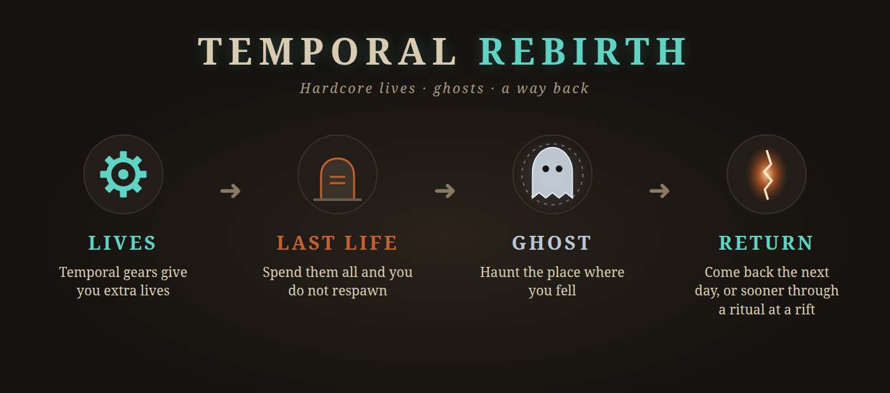

# Temporal Rebirth



Vintage Story 1.22.7 mod for hardcore worlds (`playerlives` set to a number). Lives you can earn,
and a way back for players who run out of them.

1. **Earn lives with temporal gears.** Using a gear the vanilla way (hold right click on the
   ground to set your respawn point) also grants extra lives. One per gear by default.
2. **Out of lives → ghost.** Instead of being stuck on the death screen, a player with no lives
   left becomes a spectator and can watch the world.
   The ghost is tethered to where it died: it cannot drift more than `GhostTetherRadius`
   blocks away and is pulled back onto that edge.
3. **Come back the next day.** A ghost returns to survival at their respawn point once the server's
   local clock passes `NextDayResetHour` on the following day. Can be switched to a fixed number
   of hours, or disabled so only a ritual works.
4. **Revival ritual at a rift.** A living player holds a temporal gear (the same 3.5 s use) within
   a few blocks of an active rift. The gear is consumed and a ghost comes back to life next to the
   caster. Only ghosts who are online can be revived. With one online ghost it is them; with more,
   the caster picks one first with `/rebirth target <name>` — otherwise the ritual lists the
   ghosts and keeps the gear.

Works with [Downed](https://mods.vintagestory.at/downed): a downed player is not dead; only the
final death (bleed out, give up, execution) costs a life. Do **not** install together with
Temporal Lives — both patch the same vanilla code; this mod replaces it.

## Config

`ModConfig/temporalrebirth.json` on the server:

| key | default | meaning |
|---|---|---|
| `LivesPerGear` | `1` | lives per gear; `-1` follows the world's `temporalGearRespawnUses` |
| `ReturnMode` | `NextDay` | `NextDay`, `Hours` or `Disabled` |
| `ReturnAfterHours` | `24` | used by `Hours` |
| `NextDayResetHour` | `6` | used by `NextDay`, server local time |
| `GhostNoClip` | `false` | `false`: ghosts fly but collide with blocks; `true`: they pass through walls |
| `GhostTetherRadius` | `24` | how far a ghost may drift from its death spot; `0` = no limit |
| `RitualRiftRange` | `8` | how close to a rift the caster must stand, in blocks |

Lives left = world `playerlives` + extra lives − vanilla death counter. With unlimited lives
(`playerlives = -1`) the mod does nothing.

## Commands

- `/rebirth lives` — your lives left
- `/rebirth ghosts` — who is waiting and when they come back
- `/rebirth target <ghost>` — choose whom your next ritual brings back
- `/rebirth revive <player>` — admin (`controlserver`): bring a ghost back where they stand
- `/rebirth setlives <player> <n>` — admin: set how many lives a player has left

## Build

Needs the .NET 10 SDK and a Vintage Story 1.22.7 install (default `~/Games/VintageStory`,
override with `VINTAGE_STORY=/path`).

```sh
dotnet build -c Release -t:Package   # -> dist/temporalrebirth_<version>.zip
```

## License

MIT, see `LICENSE`.
