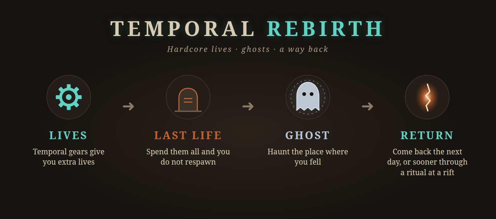

# Temporal Rebirth



Hardcore lives you can earn, and a way back when they run out. A Vintage Story mod for servers and single-player worlds.

**Download:** [Vintage Story Mod DB](https://mods.vintagestory.at/show/mod/73648) · [GitHub releases](https://github.com/Mrucznik/vs-temporal-rebirth/releases)
· **[Web configurator](https://mrucznik.github.io/vs-temporal-rebirth/configurator/)** · **[Wiki](https://github.com/Mrucznik/vs-temporal-rebirth/wiki)**

In the base game, limited lives (`playerlives`) end a character for good. This mod lets players earn more lives
and turns the loss of the last one into a penalty with an end, not a dead end. Version 0.10.

## How it works

1. **Earn lives.** Using a temporal gear (the vanilla "set respawn point" action) gives extra lives, one per gear by
   default, with an optional cap. See [Lives](https://github.com/Mrucznik/vs-temporal-rebirth/wiki/Lives).
2. **Pick a preset.** `Ghost` (the default), `Rift`, `Undead`, `Exile`, `Timeout` or `Hardcore` set everything below at once;
   `/rebirth preset <name>` or the configurator. See [Presets](https://github.com/Mrucznik/vs-temporal-rebirth/wiki/Presets).
3. **Lose the last life.** The player becomes something else, for a set time and in a set place:
   - **form:** a ghost, a spectator, a zombie, a normal player, or a banned player
     ([Afterlife Forms](https://github.com/Mrucznik/vs-temporal-rebirth/wiki/Afterlife-Forms));
   - **place:** where they died, the spawn point, a marked place (an exile), or a zone made of land claims
     ([Place and Exile](https://github.com/Mrucznik/vs-temporal-rebirth/wiki/Settings-Guide#place-and-zones));
   - **time:** real time, such as 24 hours or until 06:00 the next day, or until someone brings them back
     ([Time and Return](https://github.com/Mrucznik/vs-temporal-rebirth/wiki/Settings-Guide#time-and-return)).
4. **Come back.** When the time is up, or sooner when a living player holds a temporal gear for 3.5 s in the right
   place (next to the player by default, or by a rift, in a marked place or anywhere). The gear's hint says whether a
   ritual works where you stand; with several players waiting a list asks whom to bring back. The gear is used up
   ([Rituals](https://github.com/Mrucznik/vs-temporal-rebirth/wiki/Rituals)).

Everything is configurable, and all texts come in English, Polish, German and Russian
([Configuration](https://github.com/Mrucznik/vs-temporal-rebirth/wiki/Configuration),
[Commands](https://github.com/Mrucznik/vs-temporal-rebirth/wiki/Commands-and-Permissions),
[Messages](https://github.com/Mrucznik/vs-temporal-rebirth/wiki/Messages-and-Translations)).
Config from 0.6.x is converted automatically and behaves as before.

## Quick start

1. Put the mod in the server's `Mods` folder (clients get it when they join) and turn on limited lives:
   `/worldconfig playerlives 3`, then restart. Without a limit the mod does nothing.
2. Choose settings in the [configurator](https://mrucznik.github.io/vs-temporal-rebirth/configurator/) and paste its
   `/rebirth import ...` command in game, or use `/rebirth preset` and `/rebirth config <setting> <value>`.
3. Check with `/rebirth config show`. More in [Installation](https://github.com/Mrucznik/vs-temporal-rebirth/wiki/Installation).

## Compatibility

- Vintage Story **1.22.7**, required on the server and on every client.
- Works with [Downed](https://mods.vintagestory.at/downed) (soft, no assembly reference): being downed can cost a life.
- Do **not** install it together with Temporal Lives: both patch the same vanilla code, and this mod replaces it.

Details: [Compatibility](https://github.com/Mrucznik/vs-temporal-rebirth/wiki/Compatibility), [FAQ](https://github.com/Mrucznik/vs-temporal-rebirth/wiki/FAQ).

## Build

Needs the .NET 10 SDK and a Vintage Story 1.22.7 install (default `~/Games/VintageStory`,
override with `VINTAGE_STORY=/path`).

```sh
dotnet build -c Release -t:Package   # -> dist/temporalrebirth_<version>.zip
```

## License

MIT, see `LICENSE`.
